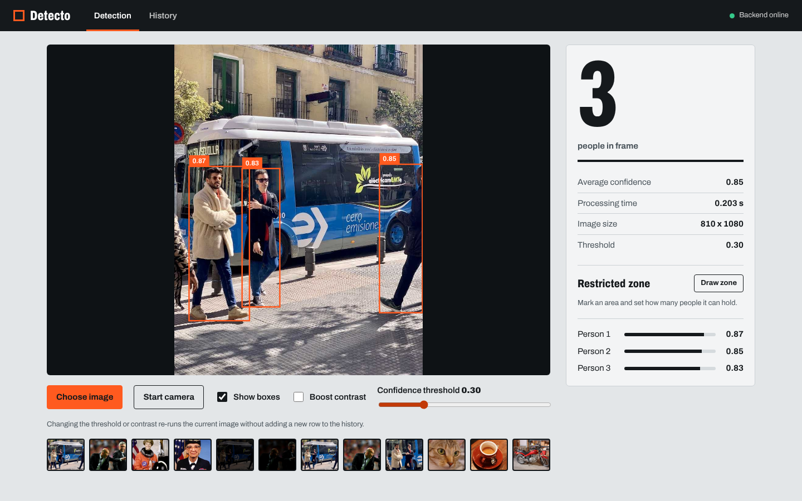
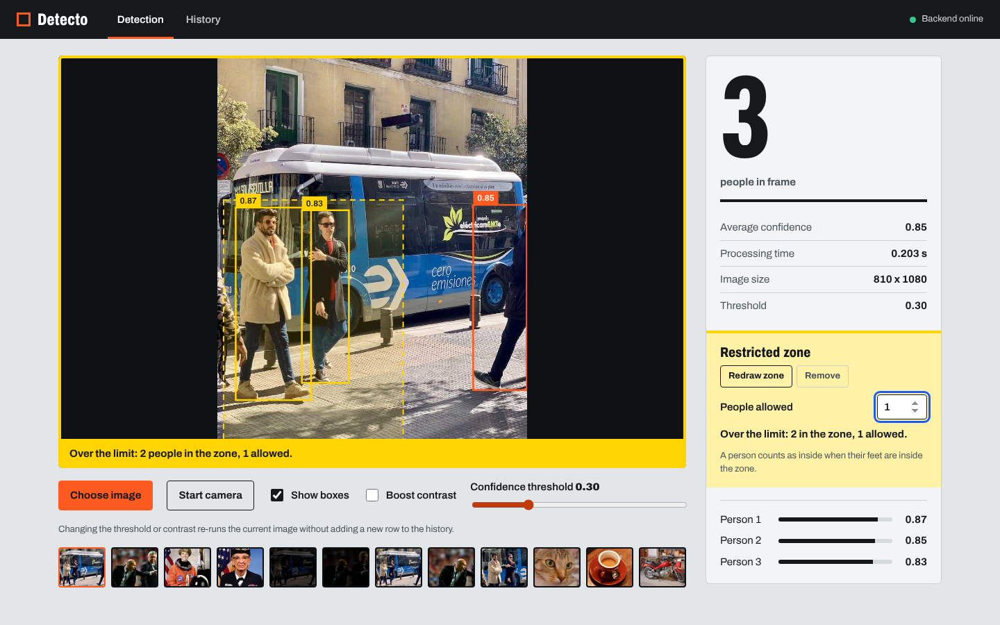
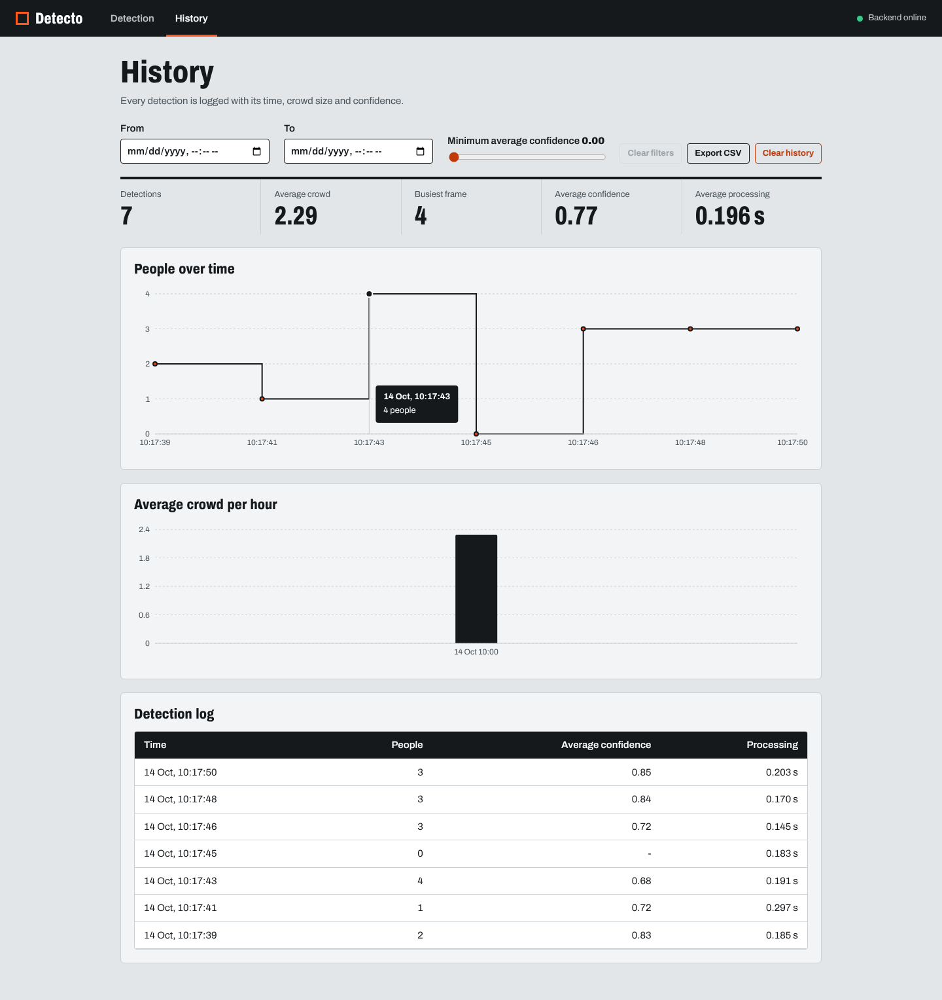
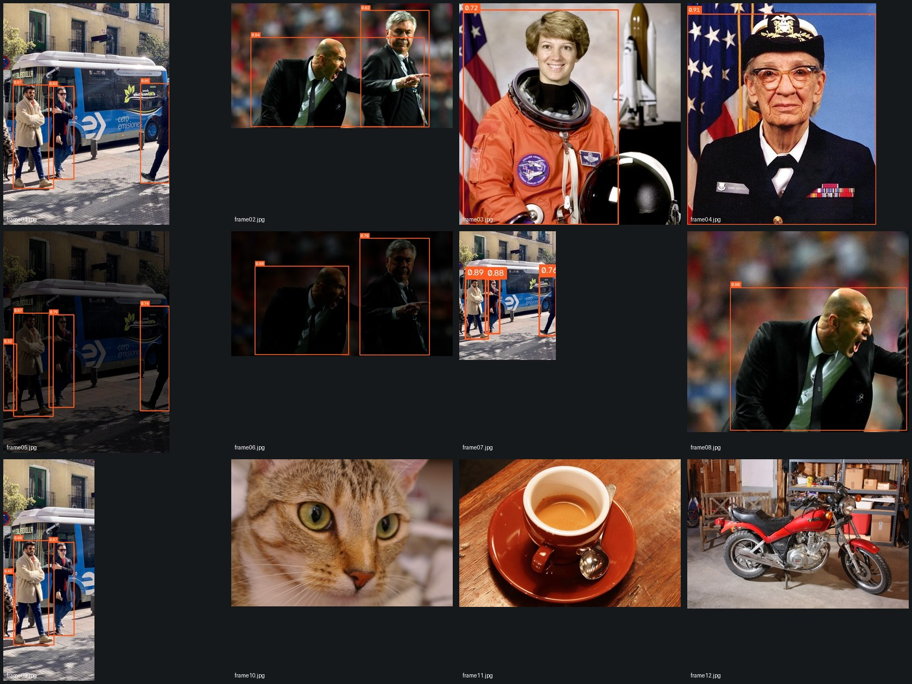
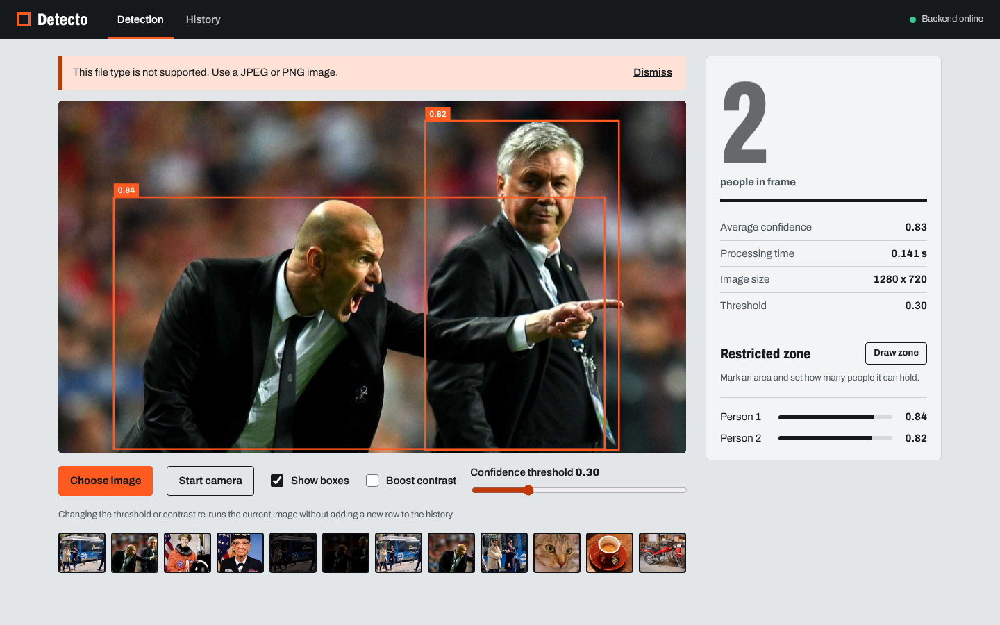

# Detecto

Detecto counts the people in an image. You upload a photo (or point a camera at a room), the backend runs a pretrained YOLOv8 model, and the dashboard draws a box around every person with a confidence score, the total count and the time the model took. Every detection is logged to a local database, so a second page can show how crowded a space was over time.

It was built for the Zone01 Kisumu "Detecto" project. The idea is an operator watching an entrance, a classroom or a warehouse who needs a quick visual answer to "how many people are there right now?".

The model is not trained here. Detecto uses the pretrained `yolov8n` weights from Ultralytics, trained on the COCO dataset where `person` is class 0, and keeps only that class.

## Architecture

```
  Browser (React + Vite)                FastAPI backend                 Storage
  ----------------------                -----------------               -------
  Detection page   --- POST /detect --> validate file
  (upload, samples,    multipart or     decode + preprocess
   camera, zone)       base64           YOLOv8n (loaded once)  ---->   SQLite
                  <--- JSON + image --- count, boxes, confidence        detections.db
  History page     --- GET /history -->
  (table, charts,      GET /stats       query with filters      <----
   filters, CSV)       GET /history/export
                       DELETE /reset
```

| Part | Tech | Job |
|---|---|---|
| Frontend | React 19, Vite, Recharts, React Router | Two pages, draws boxes on a canvas from the JSON coordinates |
| Backend | FastAPI, Ultralytics YOLOv8n, OpenCV, Pillow | Validates images, runs inference, logs results |
| Storage | SQLite (`detections.db`) | One row per detection: timestamp, count, average confidence, inference time |

### What happens to one image

1. The file is checked. The backend decodes the actual bytes with Pillow, so a text file renamed to `.jpg` is rejected instead of trusted by its extension.
2. Preprocessing: EXIF rotation is fixed, the image is converted to RGB, and anything with a side longer than 1280 px is scaled down. An optional contrast boost (CLAHE) can be switched on from the UI.
3. YOLOv8n runs with `classes=[0]` and the chosen confidence threshold.
4. The result is saved (count, average confidence, inference time, timestamp) and returned as JSON, together with an overlay image if requested.
5. The frontend draws the boxes itself on a canvas from the coordinates, which keeps them sharp and lets the user toggle them.

The model is loaded once when the server starts and warmed up with a dummy image, so the first real request is not slow.

## Features

Required:

- Detection page: upload, drag and drop, or pick one of 12 samples. Shows boxes, total count, confidence for each person and processing time per frame.
- History page: table and line chart of people over time, with filters for date and time range and for minimum average confidence.
- Clear error messages for unsupported, empty, oversized and damaged files, on both the frontend and the API.
- `/detect`, `/history` and `/reset` endpoints, SQLite storage, and performance logging for every request.

Bonus (done):

- Live camera mode in the browser. A frame is grabbed about every 400 ms and sent to `/detect`. Only one frame every 5 seconds is saved to the history so the log does not flood.
- Restricted zone alert. Draw a rectangle on the image, set how many people it can hold, and the stage turns yellow with a warning when the limit is exceeded. A person counts as inside when their feet (bottom centre of the box) are inside the zone.
- Statistics panel with average crowd per hour, busiest frame and average confidence.
- CSV export of the history, respecting the active filters.

Not done: heatmaps and movement tracking lines.

## Project structure

```
detecto/
├── backend/
│   ├── main.py                 app, CORS, router mounting
│   ├── config.py               settings read from .env
│   ├── evaluate.py             evaluation script (metrics table)
│   ├── routes/
│   │   ├── detect.py           POST /detect
│   │   └── history.py          GET /history, /stats, /history/export, DELETE /reset
│   ├── models/record.py        SQLite access
│   ├── utils/
│   │   ├── preprocessing.py    decode, validate, resize, contrast
│   │   ├── inference.py        YOLO model and detect_people()
│   │   └── overlay.py          draws boxes for returned images
│   ├── samples/                12 test images and ground_truth.json
│   └── tests/                  pytest suite (22 tests)
├── frontend/
│   ├── public/samples/         the same 12 images for the sample picker
│   └── src/
│       ├── pages/              Detection.jsx, History.jsx
│       ├── components/         Stage, Readout, Charts, SamplePicker, Notice
│       ├── lib/                geometry and formatting helpers (with tests)
│       └── App.jsx
├── docs/                       evaluation results and screenshots
├── scripts/make_samples.py     rebuilds the sample images
├── requirements.txt            runtime dependencies
├── requirements-dev.txt        adds pytest and httpx
└── .env.example                copy to .env
```

The `weights/` folder and `detections.db` are created on first run and are ignored by git.

## Setup and run

You need Python 3.10 or newer and Node.js 20 or newer. It was developed with Python 3.13 and Node 22.

### Backend

```bash
git clone https://learn.zone01kisumu.ke/git/waonyango/detecto
cd detecto

python -m venv venv
source venv/bin/activate          # Windows: venv\Scripts\activate
pip install -r requirements.txt
cp .env.example .env

cd backend
uvicorn main:app --reload
```

The API is now at http://localhost:8000 and FastAPI's interactive docs are at http://localhost:8000/docs.

The first start downloads `yolov8n.pt` (about 6 MB) into `weights/`, so it needs an internet connection once. If you are offline, put the file at `weights/yolov8n.pt` yourself. The install is large because it pulls in PyTorch. Without an NVIDIA GPU, the CPU build of PyTorch from pytorch.org is much smaller.

### Frontend

In a second terminal:

```bash
cd detecto/frontend
cp .env.example .env
npm install
npm run dev
```

Open http://localhost:5173. The top right corner shows whether the backend is reachable.

### Configuration

Backend settings live in the root `.env` (all have defaults, so the app also runs without the file):

| Variable | Default | Meaning |
|---|---|---|
| `MODEL_PATH` | `weights/yolov8n.pt` | Where the model weights are read from or downloaded to |
| `CONF_THRESHOLD` | `0.3` | Default confidence cutoff |
| `MAX_IMAGE_SIDE` | `1280` | Larger images are scaled down to this |
| `MAX_UPLOAD_MB` | `15` | Upload size limit |
| `DB_PATH` | `detections.db` | SQLite file |
| `FRONTEND_ORIGIN` | `http://localhost:5173` | Origin allowed by CORS |

The frontend reads `VITE_API_URL` from `frontend/.env` (default `http://localhost:8000`). The `.env` files hold no secrets, but they are ignored by git, so `.env.example` is what gets committed.

### API quick reference

| Method and path | Purpose |
|---|---|
| `POST /detect` | Form field `file` (JPEG or PNG) or `image_base64`. Optional `conf`, `enhance`, `overlay`, `save`. Returns count, boxes, confidences, processing time and the overlay image as base64. |
| `GET /history` | Saved detections, newest first. Query: `min_confidence`, `start`, `end`, `limit`. |
| `GET /stats` | Totals plus average crowd per hour, same filters. |
| `GET /history/export` | The same rows as a CSV download. |
| `DELETE /reset` | Deletes all saved detections. |
| `GET /health` | Returns `{"status": "ok"}`. |

```bash
curl -X POST http://localhost:8000/detect -F "file=@backend/samples/frame02.jpg"
```

Errors use plain messages in a `detail` field: 400 for a missing or empty file or a bad threshold, 413 for a file over the size limit, 415 for anything that is not JPEG or PNG, 422 for a file that cannot be decoded or invalid base64.

## Testing

Backend and frontend are tested separately.

```bash
# backend (from the repo root, with the venv active)
pip install -r requirements-dev.txt
cd backend
python -m pytest

# frontend
cd frontend
npm test
```

The backend suite has 22 tests: counting on real images, base64 input, every error status, the threshold behaviour, saving and skipping history, filters, stats, CSV export and reset. The frontend suite has 7 tests for the zone geometry (what counts as being inside the restricted zone).

I also ran the full app in a real browser (Chromium driven by Playwright) against a fresh copy of the repository with no weights, no `.env` and no `node_modules`. It covered: the backend status badge, clicking samples, a text file and a renamed text file being rejected with clear messages, moving the threshold slider, the camera loop with Chrome's fake camera feed, the History table and both charts, the confidence filter, CSV export, clearing the history and the not-found page. All 16 checks passed. That browser script is not part of the repo.

## Evaluation

### Method

The 12 images in `backend/samples/` are the test set. The expected values are in `backend/samples/ground_truth.json`:

1. For each image, the visible people were counted by eye. People who are mostly cut off by the image edge still count if a clear part of them is visible.
2. `python evaluate.py` runs the same pipeline the API uses (decode, preprocess, YOLOv8n) on every image and saves the overlay images to `backend/results/conf_0.30/`.
3. Each overlay was checked by eye for boxes that are not on a person. Those are the false positives recorded in the ground truth file.
4. Correct detections = boxes on real people. The formulas are the ones from the project brief:
   - Detection accuracy = correct detections / total visible people
   - False positives = boxes without a person / total boxes
   - Average inference time = mean time per image (one warm-up run first, then the mean of 3 repeats per image)
   - Average confidence = mean confidence of all valid detections
   - Reliability = images processed without an error / total images

To reproduce:

```bash
cd backend
python evaluate.py --sweep
```

Measured on a 2-core Intel Xeon @ 2.80 GHz, CPU only, PyTorch 2.14, confidence threshold 0.30.

### Results

| Metric | Result | Target | Status |
|---|---|---|---|
| Detection accuracy | 90.9% (20 of 22 people) | >= 85% | pass |
| False positives | 0.0% (0 of 20 boxes) | <= 10% | pass |
| Average inference time | 0.125 s | <= 1.5 s | pass |
| Average confidence | 0.782 | >= 0.7 | pass |
| System reliability | 100% (12 of 12 images) | 100% | pass |

Per image:

| Image | Visible | Detected | Correct | False pos. | Time (s) | Note |
|---|---|---|---|---|---|---|
| frame01.jpg | 4 | 3 | 3 | 0 | 0.139 | Two people clear, two cut off at the left and right edges |
| frame02.jpg | 2 | 2 | 2 | 0 | 0.113 | Two people in close-up, blurred crowd behind not counted |
| frame03.jpg | 1 | 1 | 1 | 0 | 0.152 | Single portrait with space suit |
| frame04.jpg | 1 | 1 | 1 | 0 | 0.160 | Single portrait, head and shoulders |
| frame05.jpg | 4 | 4 | 4 | 0 | 0.111 | Frame 1 darkened, low light |
| frame06.jpg | 2 | 2 | 2 | 0 | 0.090 | Frame 2 darkened, low light |
| frame07.jpg | 4 | 3 | 3 | 0 | 0.128 | Frame 1 shrunk to 178 px wide, people small like in a far camera |
| frame08.jpg | 1 | 1 | 1 | 0 | 0.166 | Frame 2 cropped, second person reduced to a sliver of sleeve |
| frame09.jpg | 3 | 3 | 3 | 0 | 0.091 | Frame 1 cropped, one person cut off at the left edge |
| frame10.jpg | 0 | 0 | 0 | 0 | 0.120 | Cat, no people |
| frame11.jpg | 0 | 0 | 0 | 0 | 0.120 | Coffee cup, no people |
| frame12.jpg | 0 | 0 | 0 | 0 | 0.110 | Motorcycle in a garage, no people |

The same output is saved in [docs/evaluation-results.md](docs/evaluation-results.md).

### Choosing the confidence threshold

The threshold changes how many people are found. Using counts only (no manual review of the extra boxes), the sweep gave:

| Confidence | Detected | Est. accuracy | Est. false pos. | Avg confidence |
|---|---|---|---|---|
| 0.25 | 21 | 95.5% | 0.0% | 0.758 |
| 0.30 | 20 | 90.9% | 0.0% | 0.782 |
| 0.40 | 19 | 86.4% | 0.0% | 0.806 |
| 0.50 | 18 | 81.8% | 0.0% | 0.828 |
| 0.60 | 18 | 81.8% | 0.0% | 0.828 |
| 0.70 | 17 | 77.3% | 0.0% | 0.835 |

A higher threshold raises the average confidence but loses people who are partly hidden. At 0.50, a common default, the estimated accuracy drops to 81.8%, below the 85% target. 0.30 keeps accuracy above the target with no false positives and an average confidence still well over 0.7, so it is the default. The slider on the Detection page (0.10 to 0.90) lets an operator change it. Only the 0.30 row was checked by eye for false positives. The other rows are estimates and could hide false positives that a count cannot show.

### Screenshots

Detection of the first sample (3 people, boxes with confidence, processing time on the right):



Restricted zone alert. A zone is drawn on the image, the limit is 1, and 2 people are standing inside it:



History page with the people-over-time chart, average crowd per hour and the log table:



All 12 test images with their boxes at threshold 0.30:



An unsupported file is refused with a clear message and the previous result stays on screen:



### Failures and limits

- **Edge-cut person missed (frame01, frame07).** Both misses are the same person: someone in a leopard-print coat at the left edge of the bus photo, with only a sliver of their body in the frame. In frame01 their box has a confidence of 0.287, just under the 0.30 cutoff, so it is dropped (it appears if the threshold is lowered to 0.25). The same person is found in the darkened copy (frame05, confidence 0.32) and the cropped copy (frame09, confidence 0.42), and missed again in the version shrunk to 178 px (frame07). This one person appears in four images, so they account for both misses. If they were left out of the ground truth, the other 18 counted people would all be found.
- **Small and distant people (frame07).** The other three people in the 178 px image are still found, with confidence 0.76 to 0.89, so YOLOv8n copes with small subjects better than expected. The limit shows up with the one person who was already hard.
- **Low light (frame05, frame06).** Darkening the photos did not lose anyone, but confidence moved: the person at the right edge of the bus photo went from 0.85 to 0.74, and the man on the right in the two-men photo went from 0.82 to 0.70, while the man on the left went up from 0.84 to 0.88. The darkened bus copy found the edge person that the original missed (0.32 against 0.29), which says more about how close that detection sits to the cutoff than about low light helping. The optional contrast boost exists for dark scenes but was not needed on this set.
- **Overlapping people (frame02).** The two men stand close together and their boxes overlap heavily, but both are found.
- **Ground truth is a judgement call.** Whether a sliver of a sleeve (frame08) or a person at the edge counts as "visible" is subjective. The counts here are conservative for the edge cases and do not count the sleeve.
- **The test set is small and not very varied.** The 12 images come from 7 source photos: 5 of them are darkened, shrunk or cropped copies of the bus and the two-men photos, and 3 contain no people at all. No image has more than 4 people, and there is no real crowd. The 22 visible people also mean one miss moves accuracy by about 4.5 points. These numbers show the pipeline works, but they do not prove it handles a busy hall. Add your own photos of groups to `backend/samples/` and `ground_truth.json` and re-run `evaluate.py` for a stronger result.
- **Timing is CPU only.** The 0.125 s average comes from a 2-core server CPU. Other machines will differ, so re-run the script on the machine you demo on.

### What worked and what could be improved

Worked well:

- Loading the model once and warming it up keeps every request near 0.1 to 0.2 s on a CPU.
- Decoding the real bytes instead of trusting the file extension makes the error handling reliable.
- Re-running the current image when the threshold or contrast changes (without saving a new history row) makes tuning fast and keeps the log clean.
- Splitting `evaluate.py`, the API and the model code over shared helpers means the evaluation measures exactly what the API does.

Could be improved:

- Test on a bigger and more varied set, ideally some CrowdHuman images with real crowds and occlusion.
- Try `yolov8s` or tile large images to catch very small or distant people.
- Track people between camera frames so the same person is not counted again and movement lines or heatmaps become possible.
- Paginate the history table on the server for very large logs and split the charts into their own bundle (the production build warns that one chunk is over 500 kB).
- Add authentication before exposing the API outside a local network.

## Sample images

The sample images come from sample data shipped inside Python packages (Ultralytics, scikit-image and Matplotlib). `scripts/make_samples.py` rebuilds them, including the darkened, shrunk and cropped variants. Check each package's licence before reusing the images outside this project.

## Resources

- [Ultralytics YOLOv8 documentation](https://docs.ultralytics.com/)
- [FastAPI documentation](https://fastapi.tiangolo.com/)
- [React](https://react.dev/) and [Vite](https://vite.dev/)
- [COCO dataset](https://cocodataset.org/)

